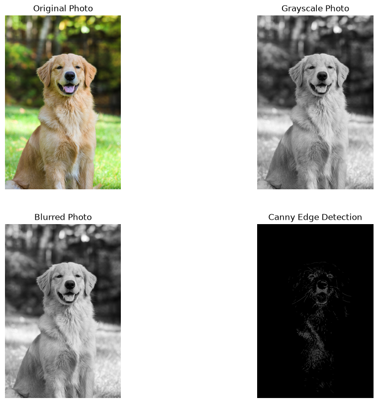

# OpenCV Image Analyzer

## Overview

This project demonstrates basic image processing techniques using Python and OpenCV.

The application read an image, extracts image metadata, converts the image to grayscale, applies Gaussian blur for noise reduction, and performs Canny edge detection to highlight object boundaries.

## Technologies Used

- Python
- OpenCV
- Matplotlib
- Jupyter Notebook

## Project Workflow

```text
Original Image
    |
    v
RGB Conversion
    |
    v
Gaussian Blur
    |
    v
Canny Edge Detection
```

## Image Information

The script extracts:

- Image Height
- Image Width
- Number of Channels
- Total Pixel Count

## Features

### 1. Image Loading

Reads image from disk using OpenCV.

### 2. Shape Analysis

Extracts:

- Height
- Width
- Channels

### 3. Grayscale Conversion

Reduces image complexity by converting a 3-channel image into a single-channel grayscale image.

### 4. Gaussian Blur

Applies noise reduction before edge detection.

### 5. Edge Detection

Uses the Canny Edge Detection algorithm to identify object boundaries.

### 6. Output Generation

Saves:

- Grayscale Image
- Blurred Image
- Edge Detection Image
- Full Pipeline Comparison

## Sample Results

### Processing Pipeline



## Project Structure

```text
01-opencv-image-analyzer
|
|--notebooks
|   |--image_analyzer.ipynb
|
|--src
|   |--image_analyzer.py
|--images
|   |--sample.jpg
|   |--outputs
|
|--requirements.txt
|
|--README.md
```

## How to Run

Install dependencies:

```bash
pip install -r requirements.txt
```
Run:

```bash
python src/image_analyzer.py
```

## Skills Demonstrated

- Computer Vision Fundamentals
- OpenCV
- Image Processing
- Grayscale Conversion
- Gaussian Blur
- Edge Detection
- Data Visualization
- Python Programming

## Future Improvements

- Histogram Analysis
- Image Thresholding
- Face Detection
- Object Detection with YOLO
- Real-Time Camera Processing

## Learning Notes

During experimentation, multiple Canny Edge Detection thresholds were evaluated.

| Threshold |
|-----------|
| 100, 200 |
| 50, 150 |

The threshold pair (50,150) produced more visible object boundaries for the sample image and was therefore selected for final output.